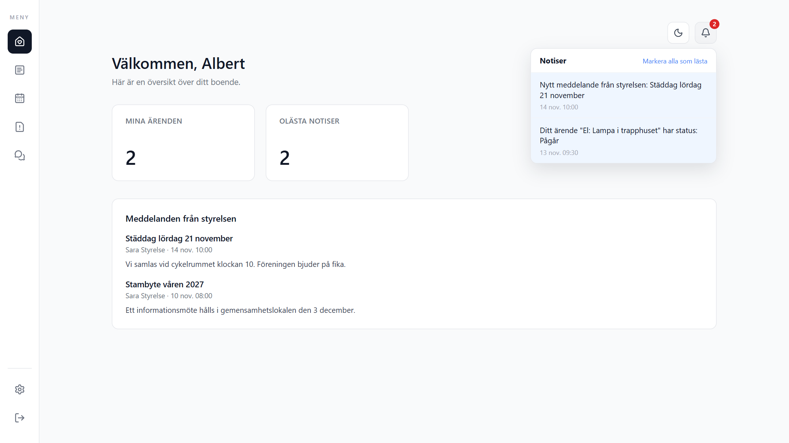
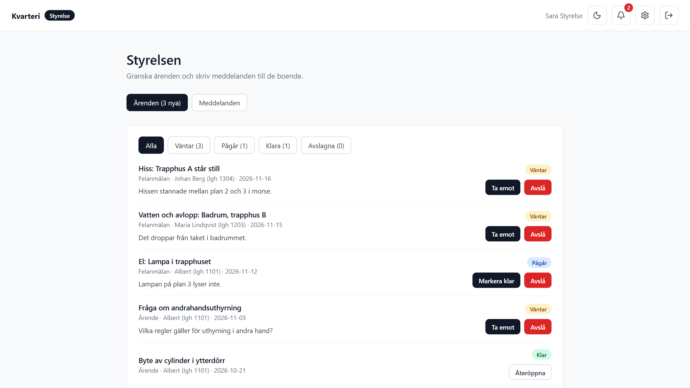
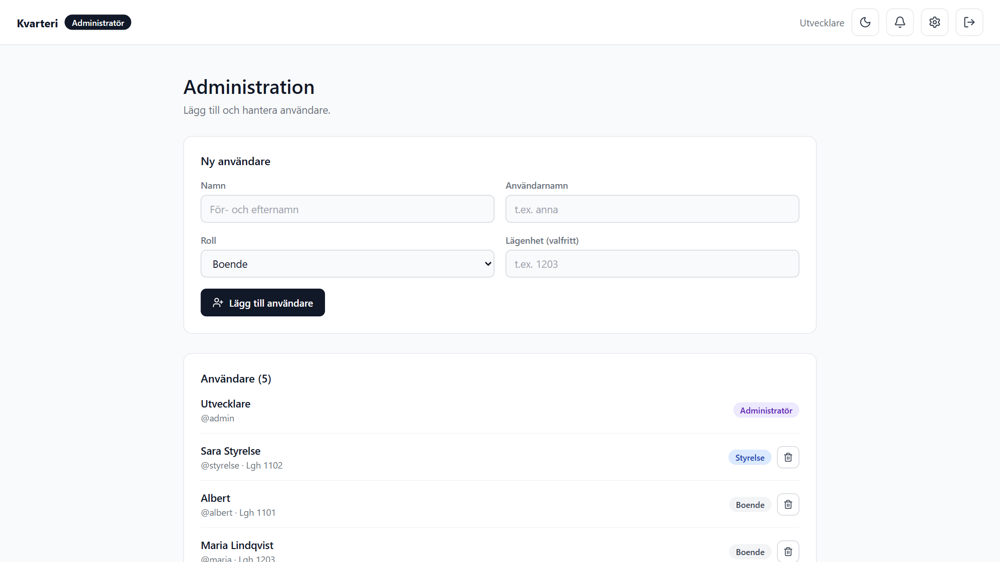
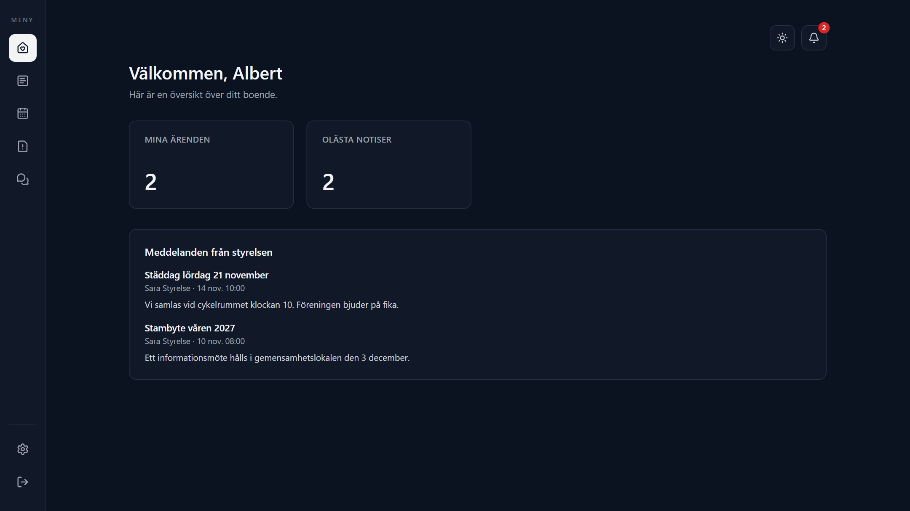

# Kvarteri

Kvarteri is a web app for apartment complexes in Sweden. It gathers tickets, fault reports, bookings and messages in one place, with a separate view for residents, board members and administrators.

This repository is the **frontend**. It is currently a working prototype: all data lives in the browser (`localStorage`), and there is no backend yet. See [Status and limitations](#status-and-limitations).

| Resident | Board |
| --- | --- |
|  |  |
| **Admin** | **Dark mode** |
|  |  |

## Features

**Residents**
- Send tickets to the board and follow their status (pending, in progress, done, rejected)
- Report faults with category, location and description
- Book the laundry room, a parking space or the community room by choosing a day and a time slot
- Read messages from the board on the start page
- Chat view (UI only, not connected yet)

**Board members**
- Review tickets: accept, mark as done, reject or reopen
- Filter tickets by status
- Publish messages to all residents

**Administrators (developers)**
- Add users with name, username, role and apartment
- Remove users (with confirmation)
- Access to every view

**Across the app**
- Role-based routes: each role is sent to its own view and blocked from the others
- Notification bell with unread count, and notifications for new tickets, status changes and board messages
- Toasts for every action
- A short sound when a new notification arrives (can be turned off in settings)
- Light and dark mode, following the device setting or chosen manually
- Settings page with a danger zone (log out, delete account)
- Responsive layout down to phone width

## Roles and demo accounts

There is no real authentication yet. Logging in looks the user up by username, and the password only needs to be filled in (any value works).

| Username | Role | Lands on |
| --- | --- | --- |
| `admin` | Administrator | `/admin` |
| `styrelse` | Board member | `/board` |
| `albert` | Resident | `/resident` |

Tip: open two browser tabs, log in as a resident in one and as a board member in the other. Changes made in one tab show up in the other, with a toast and a sound for new notifications.

## Tech stack

- [React](https://react.dev/) 19
- [Vite](https://vite.dev/)
- [React Router](https://reactrouter.com/) with nested, role-protected routes
- Context API for state (`localStorage` for persistence, `storage` events for syncing between tabs)
- Plain CSS with variables for theming
- [lucide-react](https://lucide.dev/) for icons
- [oxlint](https://oxc.rs/docs/guide/usage/linter) for linting

## Getting started

Requires Node.js and npm.

```bash
npm install
npm run dev
```

Then open http://localhost:5173/.

| Script | What it does |
| --- | --- |
| `npm run dev` | Start the dev server |
| `npm run build` | Build for production into `dist/` |
| `npm run preview` | Preview the production build |
| `npm run lint` | Lint the code with oxlint |

To reset all demo data, clear the site's `localStorage` in your browser's dev tools.

## Project structure

```
src/
├─ App.jsx                 Routes and providers
├─ main.jsx                Entry point
├─ index.css               Global styles and theme variables
├─ context/
│  ├─ AppContext.jsx       Users, tickets, messages, notifications, session
│  └─ ThemeContext.jsx     Light/dark/system theme
├─ components/
│  ├─ Login/               Login form
│  ├─ NotificationBell/    Notification dropdown
│  ├─ RequireRole/         Route guard
│  ├─ ResidentGreeting/    Welcome header
│  ├─ Settings/            Settings view
│  ├─ Sidebar/             Resident navigation
│  ├─ StaffLayout/         Shell for the board and admin views
│  ├─ ThemeToggle/         Light/dark switch
│  ├─ Toast/               Toast provider and styles
│  └─ ViewCard/            Stat card
├─ pages/
│  ├─ Login/
│  ├─ ResidentView/        Layout and home for residents
│  ├─ Errand/              Tickets
│  ├─ Booking/             Laundry, parking and community room
│  ├─ Incident/            Fault reports
│  ├─ Chat/
│  ├─ Board/               Board view
│  ├─ Admin/               Admin view
│  └─ Settings/
├─ styles/                 Shared styles for the resident pages
└─ utils/                  Roles, labels, date helpers and notification sound
docs/screenshots/          Images used in this README
```

## Status and limitations

This is a frontend prototype, built to show the design and the flows.

- **No backend.** Data is stored in the browser and is not shared between devices.
- **No real authentication.** The login only looks up the username, and passwords are not checked.
- **Notifications are not real-time.** They sync between tabs in the same browser only.
- **Chat is a placeholder.** Messages are not delivered to anyone.
- **Bookings are not saved.** The booking page confirms with a toast, but does not block the chosen slot.

## Roadmap

- [ ] Backend and database
- [ ] Real authentication and sessions
- [ ] Real-time notifications
- [ ] Working chat between residents and the board
- [ ] Booking of the garage, and saved bookings that block taken slots
- [ ] Tests and CI
- [ ] Deployment
